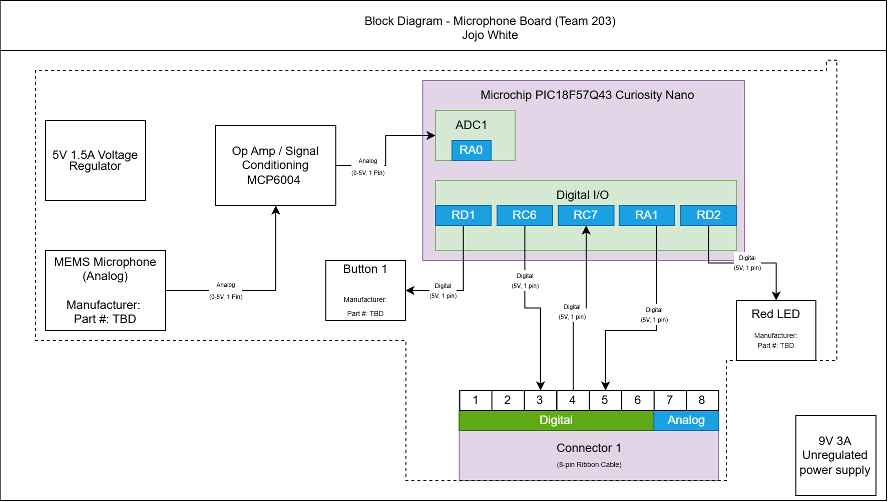

## Overview

This block diagram illustrates the major components and signal connections for the Team 203 microphone detection subsystem.

The microphone converts acoustic signals into electrical signals. These signals are amplified by a Microchip MCP6004 operational amplifier and passed through a low-pass filter before reaching the ADC input on the Microchip PIC18F57Q43 Curiosity Nano development board.

The microcontroller converts the amplified microphone signal into a digital value using its 12-bit ADC. The signal can then be reproduced through the 8-bit DAC or transmitted to other team subsystems using UART communication.

The PCB pushbutton provides a digital input to the microcontroller, while the red LED receives a digital output from the microcontroller.

The power architecture uses an external 9–12 V DC power supply and an LM7805 linear voltage regulator to provide a regulated 5 V rail.

## Microcontroller Pin Assignments

| Pin | Function | Direction |
|---|---|---|
| RA0 | Microphone ADC | Input |
| RA1 | Sound Detection (INT_OUT) | Output |
| RA2 | DAC | Output |
| RC6 | Team UART TX | Output |
| RC7 | Team UART RX | Input |
| RD1 | PCB Pushbutton | Input |
| RD2 | PCB Red LED | Output |
| RB4 | Nano Pushbutton | Input |
| RF3 | Nano Yellow LED | Output |
| RF0 | PuTTY UART TX | Output |
| RF1 | PuTTY UART RX | Input |

## Block Diagram

