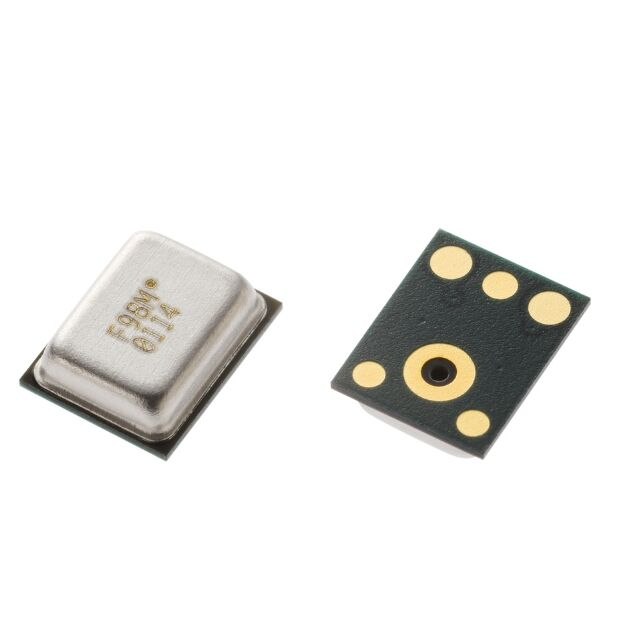
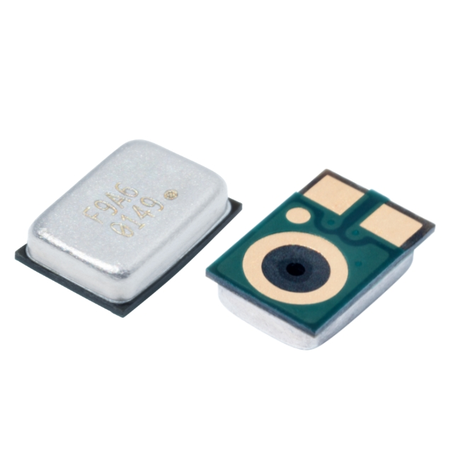
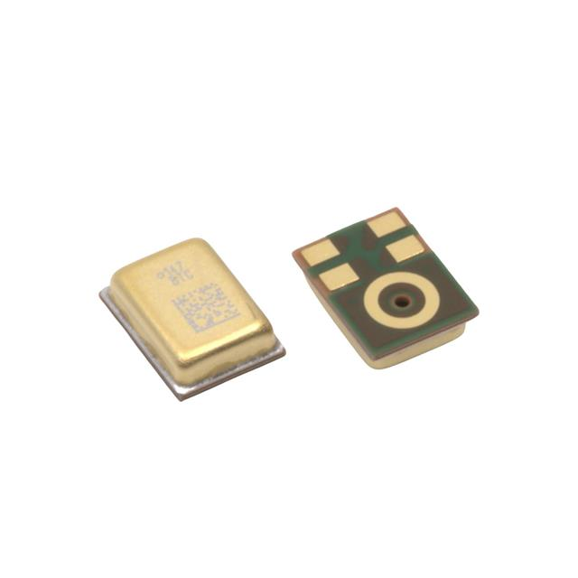
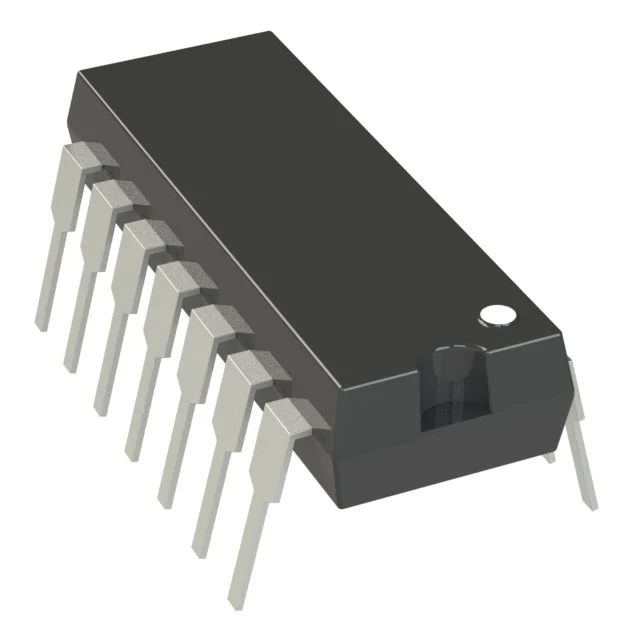
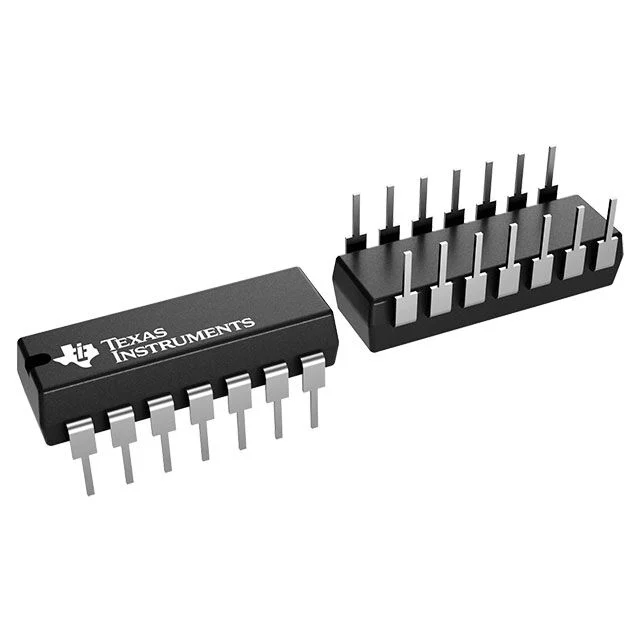
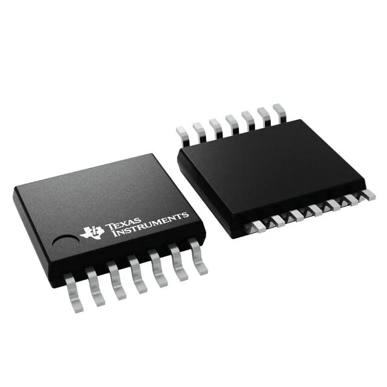
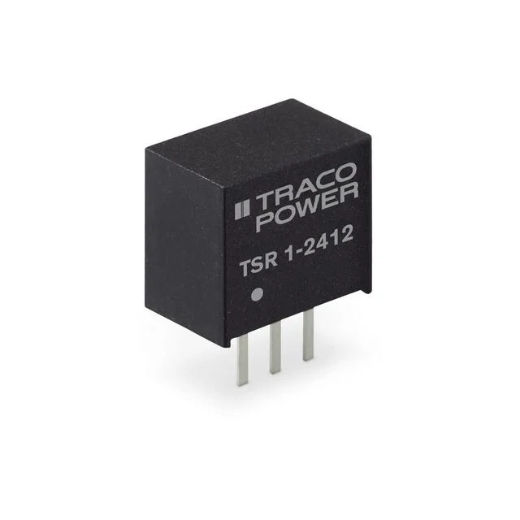
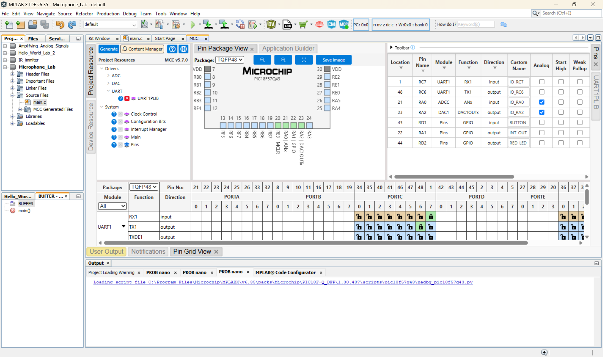

# Component Selection — Microphone Subsystem

**EGR 304 | Team 203 | Joseph White**

**Updated: November 25, 2026**

## Introduction

The microphone subsystem detects sound for the team's interactive cat-toy project. An analog electret condenser microphone feeds a signal-conditioning amplifier and low-pass filter, which supplies the RA0 ADC input on the PIC18F57Q43 Curiosity Nano.

The subsystem uses an external 9 V DC wall adapter and an STMicroelectronics L7805ABV voltage regulator to provide a regulated 5 V supply.

Components were evaluated based on electrical compatibility, power consumption, PCB integration, cost, availability, and audio performance.

---

## 1. Microphone Selection

The following microphones were evaluated during the preliminary design phase.

| Solution | Pros | Cons |
|---|---|---|
|  **3S 3SM121MZB1UA** Analog MEMS microphone [DigiKey](https://www.digikey.com/en/products/detail/3s-solid-state-system/3SM121MZB1UA/21720805) | 66 dBA SNR Low power consumption Single-ended analog output | Requires 1.6–3.6 V supply Small LGA package Requires additional voltage regulation |
|  **3S 3SM122KZB1VD-002-R** Analog MEMS microphone [DigiKey](https://www.digikey.com/en/products/detail/3s-solid-state-system/3SM122KZB1VD-002-R/21720794) | Small footprint Low power consumption Single-ended output | Requires lower-voltage supply Difficult to hand solder |
|  **Syntiant SPH11C3LR5H-1** Differential analog MEMS microphone [DigiKey](https://www.digikey.com/en/products/detail/syntiant/SPH11C3LR5H-1/17878607) | High SNR Good noise rejection Wide audio frequency response | Differential output increases circuit complexity Requires lower-voltage supply |
| **Option 4 — Existing two-wire electret condenser microphone** | Already available Simple analog interface Easy to assemble No separate 3.3 V regulator required in the implemented circuit | Manufacturer and exact part number unidentified Electrical specifications are not fully documented |

### Selected Microphone

**Choice: Option 4 — Two-wire electret condenser microphone.**

The original MEMS microphone options required additional voltage regulation and more complicated PCB assembly.

The existing electret condenser microphone was selected because it was already available and could be integrated into the analog signal-conditioning circuit using a simple resistive bias network.

| Characteristic | Selected Component |
|---|---|
| Microphone type | Electret condenser |
| Output | Analog |
| Connections | Two-wire |
| Manufacturer | Unidentified |
| Part number | Unidentified |
| Bias supply | 5 V rail through 2.2 kΩ resistor |
| Schematic reference | MK1 |
| Availability | Owned |

The microphone is biased through resistor R6. Capacitor C4 provides AC coupling between the microphone and amplifier circuit.

The selected microphone was installed on the manufactured subsystem and tested during hardware verification.

---

## 2. Operational Amplifier / Signal Conditioning

| Solution | Pros | Cons |
|---|---|---|
|  **Microchip MCP6004-I/P** Quad operational amplifier, DIP-14 [DigiKey](https://www.digikey.com/en/products/detail/microchip-technology/MCP6004-I-P/523060) | Operates from 1.8–6 V Compatible with 5 V supply Rail-to-rail input and output Low current consumption | Four amplifier channels may be unnecessary 1 MHz gain-bandwidth product |
|  **Microchip MCP6002-I/P** Dual operational amplifier, DIP-8 [DigiKey](https://www.digikey.com/en/products/detail/microchip-technology/MCP6002-I-P/500875) | Smaller package Low power consumption Rail-to-rail operation | Only two amplifier channels Requires schematic and footprint changes |
|  **Texas Instruments LM324AN** Quad operational amplifier, DIP-14 | Inexpensive Four amplifier channels Single-supply operation | Not rail-to-rail Reduced output swing near positive supply rail |

### Selected Operational Amplifier

**Choice: Microchip MCP6004-I/P.**

The MCP6004 was selected because it operates from the regulated 5 V supply and provides rail-to-rail input and output capability.

The amplifier increases the microphone signal amplitude before the signal is passed through the low-pass filter and sampled by the microcontroller ADC.

| Characteristic | Specification |
|---|---|
| Manufacturer | Microchip Technology |
| Part number | MCP6004-I/P |
| Package | DIP-14 |
| Supply voltage | 5 V in this subsystem |
| Amplifier channels | 4 |
| Gain-bandwidth product | 1 MHz |
| Schematic reference | U3 |

[Manufacturer Datasheet](https://www.microchip.com/en-us/product/MCP6004)

### Amplifier and Filter Configuration

The microphone amplifier uses an inverting configuration with a 1 kΩ input resistor and a 100 kΩ feedback resistor.

The nominal inverting-stage voltage gain is:

$$
A_v=-\frac{R_8}{R_5}
=-\frac{100000}{100}
\times\frac{100}{1000}
=-100
$$

A 10 kΩ potentiometer provides an adjustable reference voltage for the non-inverting input.

The low-pass filter consists of resistor R9 and capacitor C5.

| Component | Value |
|---|---|
| R9 | 220 Ω |
| C5 | 0.22 µF |

The nominal low-pass filter cutoff frequency is:

$$
f_c=\frac{1}{2\pi RC}
$$

$$
f_c=\frac{1}{2\pi(220)(0.22\times10^{-6})}
\approx3288\text{ Hz}
$$

---

## 3. Power Regulation

The microphone subsystem requires a regulated 5 V supply.

Three voltage regulator options were evaluated.

| Solution | Pros | Cons |
|---|---|---|
| **Option 1 — STMicroelectronics L7805ABV** 5 V linear regulator TO-220 package | Already available Simple circuit design Low output noise Through-hole assembly Up to 1.5 A with appropriate operating conditions | Linear regulator produces heat Requires adequate input voltage and thermal management |
|  **Traco Power TSR 1-2450** 5 V switching regulator [DigiKey](https://www.digikey.com/en/products/detail/traco-power/TSR-1-2450/9383780) | High efficiency Lower heat dissipation Wide input voltage range | Higher cost 1 A maximum output Possible switching noise |
| **Option 3 — Texas Instruments LM7805CT/NOPB** 5 V linear regulator TO-220 package | Simple circuit design Through-hole package Similar functionality to selected regulator | Produces heat during operation Requires thermal management Would require purchasing another component |

### Selected Voltage Regulator

**Choice: STMicroelectronics L7805ABV.**

The L7805ABV was selected because it was already available, provides a regulated 5 V output, and can be integrated into the PCB using a simple through-hole footprint.

| Characteristic | Specification |
|---|---|
| Manufacturer | STMicroelectronics |
| Part number | L7805ABV |
| Regulator type | Linear |
| Output voltage | 5 V |
| Rated output current | Up to 1.5 A, subject to thermal limitations |
| Package | TO-220 |
| Subsystem input voltage | 9 V DC nominal |
| Schematic reference | U1 |
| Availability | Owned |

[STMicroelectronics L78 Series Datasheet](https://www.st.com/resource/en/datasheet/l78.pdf)

### Thermal Considerations

Linear regulator power dissipation is approximately:

$$
P=(V_{IN}-V_{OUT})I_{OUT}
$$

At an example subsystem current of 100 mA:

$$
P=(9-5)(0.1)=0.4\text{ W}
$$

Actual regulator power dissipation depends on the measured subsystem current.

### 3.3 V Regulation

A separate 3.3 V regulator was considered during preliminary design because the original MEMS microphone candidates required a lower supply voltage.

The final implemented design uses an electret condenser microphone with a resistive bias circuit. Therefore, a separate 3.3 V regulator is not included in the manufactured subsystem.

---

## 4. External Power Supply

Three external power supply approaches were considered.

| Solution | Pros | Cons |
|---|---|---|
| **Option 1 — Model 0930, 9 V DC / 3 A wall adapter** | Already available Compatible with barrel jack Provides sufficient input voltage for L7805ABV Continuous power during testing | Requires AC wall outlet Not portable |
| **Option 2 — 12 V DC wall adapter** | Commonly available Provides adequate regulator input voltage | Increases linear regulator heat dissipation Requires AC wall outlet |
| **Option 3 — 9 V battery supply** | Portable No wall outlet required | Limited operating time Reduced current capability Requires battery replacement or charging |

### Selected External Power Supply

**Choice: Model 0930 AC/DC wall adapter.**

The selected adapter was already available and provides the nominal 9 V DC input required by the microphone subsystem.

| Characteristic | Specification |
|---|---|
| Manufacturer | Unbranded |
| Model | 0930 |
| Type | AC/DC wall adapter |
| AC input | 100–240 VAC |
| Input frequency | 50/60 Hz |
| DC output | 9 V |
| Rated output current | 3 A |
| Rated output power | 27 W |
| Barrel connector polarity | Center positive |
| Availability | Owned |

The external power supply connects to barrel jack J1. A 1 A fuse provides input protection before power reaches the L7805ABV voltage regulator.

### Power Architecture

**9 V DC Wall Adapter → J1 → 1 A Fuse → L7805ABV → Regulated 5 V Supply**

The regulated 5 V supply powers the microphone bias circuit, operational amplifier, microcontroller, and indicator LEDs.

---

## 5. Microcontroller Selection

**Selected Microcontroller: Microchip PIC18F57Q43 Curiosity Nano**

The PIC18F57Q43 Curiosity Nano is the development board used for the microphone subsystem.

| Characteristic | Specification |
|---|---|
| Manufacturer | Microchip Technology |
| Microcontroller | PIC18F57Q43 |
| Development board | Curiosity Nano |
| Configured clock frequency | 64 MHz |
| ADC resolution | 12-bit |
| DAC resolution | 8-bit |
| Communication | UART |
| Programming interface | USB onboard debugger |
| Schematic reference | U2 |

[Microchip PIC18F57Q43 Product Information](https://www.microchip.com/en-us/product/PIC18F57Q43)

---

## 6. MPLAB Code Configurator (MCC)

The PIC18F57Q43 Curiosity Nano was configured using MPLAB Code Configurator in MPLAB X IDE v6.35.

### Configured Peripherals

- ADC: Microphone signal acquisition on RA0.
- DAC1: Analog signal reproduction on RA2.
- UART1: Team subsystem communication.
- UART3: USB serial debugging through PuTTY.
- GPIO: Pushbuttons, LEDs, and digital output.

### ADC Configuration

| Parameter | Configuration |
|---|---|
| Input channel | ANA0 / RA0 |
| Resolution | 12-bit |
| Positive reference | VDD |
| Negative reference | VSS |
| Result alignment | Right |
| Computation mode | Basic |
| ADC clock | 1 MHz |
| Acquisition count | 10 |

### DAC Configuration

| Parameter | Configuration |
|---|---|
| Peripheral | DAC1 |
| Output pin | RA2 |
| Resolution | 8-bit |
| Positive reference | VDD |
| Negative reference | VSS |

### UART Configuration

| Parameter | Team Communication | PuTTY Debugging |
|---|---|---|
| Peripheral | UART1 | UART3 |
| Baud rate | 9600 | 9600 |
| Data bits | 8 | 8 |
| Stop bits | 1 | 1 |
| Parity | None | None |
| TX pin | RC6 | RF0 |
| RX pin | RC7 | RF1 |
| Flow control | None | None |
| STDIO redirect | Disabled | Enabled |

### MCC Pin Assignments

| PIC Pin | Peripheral | Direction | Custom Name | Function |
|---|---|---|---|---|
| RA0 | ADC | Input | IO_RA0 | Microphone analog input |
| RA1 | GPIO | Output | INT_OUT | Digital detection output |
| RA2 | DAC1 | Output | IO_RA2 | Analog output |
| RC6 | UART1 | Output | IO_RC6 | Team UART transmit |
| RC7 | UART1 | Input | IO_RC7 | Team UART receive |
| RD1 | GPIO | Input | BUTTON | PCB pushbutton |
| RD2 | GPIO | Output | RED_LED | PCB red LED |
| RB4 | GPIO | Input | NANO_BUTTON | Nano pushbutton |
| RF3 | GPIO | Output | NANO_LED | Nano yellow LED |
| RF0 | UART3 | Output | IO_RF0 | PuTTY transmit |
| RF1 | UART3 | Input | IO_RF1 | PuTTY receive |

RA0 and RA2 are configured as analog pins. All UART and remaining GPIO pins are configured as digital signals.

### MCC Pin Configuration Screenshot

The following screenshot documents the original MCC pin configuration. The updated pin assignments are listed in the table above.

---

## 7. Team Connector Configuration

The microphone subsystem includes an eight-pin connector for interfacing with other team subsystems.

| Connector Pin | Signal | Signal Type |
|---|---|---|
| 1 | DAC_OUT | Analog |
| 2 | RA0_ADC | Analog |
| 3 | UART_TX | Digital |
| 4 | UART_RX | Digital |
| 5 | INT_OUT | Digital |
| 6 | BTN | Digital |
| 7 | LED | Digital |
| 8 | GND | Common ground |

These assignments represent the designated connector signals. Final physical connections and team communication compatibility must be confirmed during team integration.

---

## 8. Hardware Verification

The custom microphone subsystem PCB was manufactured, assembled, programmed, and tested.

The microcontroller verification firmware performs the following functions:

- Reads the amplified microphone signal using RA0.
- Converts the 12-bit ADC reading to an 8-bit DAC value.
- Reproduces the analog signal using the DAC.
- Transmits microphone readings using UART1.
- Provides ADC and DAC readings through PuTTY.
- Controls the PCB red LED using the PCB pushbutton.
- Controls the Nano LED using the Nano pushbutton.

Individual subsystem hardware verification was demonstrated to the instructor.

Final team communication and integration remain separate development activities.

[Microcontroller Code](../07-Microcontroller-Code/microcontroller-code.md)

---

## Conclusion

The final microphone subsystem uses an electret condenser microphone, Microchip MCP6004-I/P operational amplifier, STMicroelectronics L7805ABV voltage regulator, and Microchip PIC18F57Q43 Curiosity Nano.

The subsystem is powered by a model 0930 external 9 V DC wall adapter.

The final component selection eliminates the need for a separate 3.3 V voltage regulator and simplifies PCB assembly.

The manufactured subsystem has completed individual hardware verification. The remaining project activities involve final team communication and system integration.

---

## References

1. Solid State System, 3SM121MZB1UA MEMS Microphone Datasheet.
2. Solid State System, 3SM122KZB1VD-002-R MEMS Microphone Datasheet.
3. Syntiant, SPH11C3LR5H-1 FALCON Datasheet.
4. Microchip Technology, MCP6004 Operational Amplifier Datasheet.
5. Microchip Technology, PIC18F57Q43 Microcontroller Documentation.
6. STMicroelectronics, L78 Series Voltage Regulator Datasheet.
7. Traco Power, TSR 1 Series Switching Regulator Documentation.
8. Texas Instruments, LM7805 Series Voltage Regulator Documentation.
9. Model 0930 AC/DC adapter manufacturer label.
10. EGR 304 Individual Component Selection assignment instructions.
