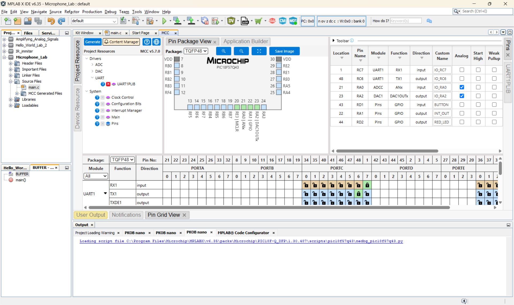

# Component Selection — Microphone Subsystem

**EGR 304 | Team 203 | Individual subsystem: Microphone**

## Introduction

The microphone subsystem detects sound for the team's interactive cat-toy project. An analog microphone feeds a signal-conditioning amplifier, which supplies the RA0 ADC input on the PIC18F57Q43 Curiosity Nano. The subsystem uses the team's planned 9 V input and regulated 5 V supply.

Components were evaluated for analog interface compatibility, power consumption, PCB integration, cost, and audio performance.

**The microphone needs a separate lower-voltage supply; it cannot be connected directly to 5 V.**

> **Design status:** The microphone choice is provisional until the schematic, PCB assembly method, and 3.3 V supply are confirmed. Prices are indicative single-unit prices and should be checked before ordering.

---

## 1. Microphone Selection

**Microphone / Acoustic Sensing**

*Table 1: Component selection comparison*

| **Solution** | **Pros** | **Cons** |
| :--- | :--- | :--- |
|  **Option 1 — 3S 3SM121MZB1UA**. Analog MEMS, 6-pin LGA; approximately **$1.16 each**. [DigiKey product](https://www.digikey.com/en/products/detail/3s-solid-state-system/3SM121MZB1UA/21720805). [Datasheet](https://mm.digikey.com/Volume0/opasdata/d220001/medias/docus/5854/3SM121MZB1UA.pdf). | 66 dBA SNR • Low 80 µA typical supply current • Single-ended analog output simplifies signal conditioning • Larger body than Option 2. | 1.6–3.6 V supply **not compatible with direct 5 V** • Bottom acoustic port requires PCB opening • LGA package is difficult to hand solder • Additional regulated supply required. |
|  **Option 2 — 3S 3SM122KZB1VD-002-R**. Analog MEMS, 4-pin LGA; approximately **$1.06 each**. [DigiKey product](https://www.digikey.com/en/products/detail/3s-solid-state-system/3SM122KZB1VD-002-R/21720794). | Very small 2.75 × 1.85 mm footprint • 80 µA typical supply current • Single-ended analog output • Omnidirectional detection. | Lower 64 dBA SNR • Requires lower-voltage rail • Small LGA package is difficult to assemble manually • Sensitive to acoustic-port contamination. |
|  **Option 3 — Syntiant SPH11C3LR5H-1**. Differential analog MEMS, 5-pin LGA; approximately **$2.12 each**. [DigiKey product](https://www.digikey.com/en/products/detail/syntiant/SPH11C3LR5H-1/17878607). | Best normal-mode SNR of the three (68.5 dBA) • Differential output improves noise rejection • Wide audio frequency response • High acoustic overload tolerance. | Higher current (~200–205 µA) • Differential output complicates signal conditioning • 2.4–3.2 V normal-mode supply • Bottom-port LGA requires careful assembly. |

### Selected Microphone

**Choice (provisional): Option 1 — 3SM121MZB1UA.**

Option 1 balances low supply current and noise performance while retaining a single-ended analog output that can be conditioned by the MCP6004 and sampled by RA0.

Compared with Option 2, it provides 2 dB better SNR for the same typical current. It also avoids the differential-output interface complexity of Option 3.

A regulated 3.3 V microphone supply and appropriate signal-conditioning network must be incorporated into the final design.

### Electrical Comparison

| Characteristic | Option 1 | Option 2 | Option 3 |
| --- | ---: | ---: | ---: |
| Supply voltage | 1.6–3.6 V | 1.6–3.6 V | 2.4–3.2 V |
| Typical current | 80 µA | 80 µA | 200–205 µA |
| Signal-to-noise ratio | 66 dBA | 64 dBA | 68.5 dBA |
| Sensitivity | −38 dBV/Pa | −38 dBV/Pa | −38 dBV/Pa |
| Output | Single-ended | Single-ended | Differential |
| Dimensions | 3.76 × 3.00 × 1.10 mm | 2.75 × 1.85 × 0.90 mm | 3.50 × 2.65 × 1.00 mm |

**Datasheet evidence:** Option 1, page 4; Option 2, page 4; Option 3, pages 2 and 6.

---

## 2. Operational Amplifier / Signal Conditioning

**Operational Amplifier / Signal Conditioning**

*Table 2: Component selection comparison*

| **Solution** | **Pros** | **Cons** |
| :--- | :--- | :--- |
|  **Option 1 — Microchip MCP6004-I/P**. Quad rail-to-rail op-amp, 14-PDIP; approximately **$0.60 each**. [DigiKey product](https://www.digikey.com/en/products/detail/microchip-technology/MCP6004-I-P/523060). | Operates from 1.8–6 V • Compatible with 5 V rail • Rail-to-rail input/output • Four amplifier channels • Low ~100 µA typical current per channel. | Four channels may be unnecessary • 1 MHz gain-bandwidth product • 14-pin DIP requires more PCB space. |
|  **Option 2 — Microchip MCP6002-I/P**. Dual rail-to-rail op-amp, 8-PDIP; approximately **$0.45 each**. [DigiKey product](https://www.digikey.com/en/products/detail/microchip-technology/MCP6002-I-P/500875). | Same 1.8–6 V supply range • Smaller and less expensive • Low power consumption. | Only two channels • Requires schematic and pinout changes • Limited high-frequency performance. |
|  **Option 3 — Texas Instruments LM324AN**. Quad general-purpose op-amp, 14-PDIP; approximately **$0.57 each**. [DigiKey product](https://www.digikey.com/en/products/detail/texas-instruments/LM324AN/412056). | Four channels • Inexpensive • Familiar architecture • Single-supply operation. | Output is not rail-to-rail • Higher input bias current • Reduced signal swing near positive supply rail. |

### Selected Operational Amplifier

**Choice: Option 1 — MCP6004.**

The MCP6004 supports operation from the regulated 5 V rail and provides rail-to-rail input/output capability.

Its low current consumption and four available amplifier channels make it suitable for conditioning the microphone signal before conversion by the PIC ADC.

The additional channels provide flexibility for amplification and filtering.

The final component package and PCB footprint must match the selected manufacturing method.

> **Photo note:** Images for options 2 and 3 are representative package photographs.

---

## 3. Power Regulation

**5 V Voltage Regulator**

The block diagram specifies a 9 V, 3 A unregulated source and a regulated 5 V, 1.5 A output.

The microphone requires an additional supply below 3.6 V.

*Table 3: Component selection comparison*

| **Solution** | **Pros** | **Cons** |
| :--- | :--- | :--- |
|  **Option 1 — STMicroelectronics L7805CV**. 5 V linear regulator, TO-220, nominal 1.5 A; approximately **$1.08 each**. [DigiKey product](https://www.digikey.com/en/products/detail/stmicroelectronics/L7805CV/585964). | Meets nominal 5 V / 1.5 A target • Simple linear design • Through-hole package • Thermal protection. | Dissipates heat proportional to input-output voltage difference • 6 W dissipation at 1.5 A from 9 V • Does not provide 3.3 V microphone supply. |
|  **Option 2 — Traco Power TSR 1-2450**. 5 V switching regulator, 1 A maximum; approximately **$6.28 each**. [DigiKey product](https://www.digikey.com/en/products/detail/traco-power/TSR-1-2450/9383780). | Lower heat dissipation • Wide 6.5–36 V input range • Convenient 3-pin package. | Only 1 A maximum • Higher cost • Switching noise may require additional filtering. |

### Selected Voltage Regulator

**Choice (provisional): Option 1 — L7805CV.**

The L7805CV meets the nominal 5 V, 1.5 A requirement and provides a straightforward linear regulation solution.

However, the regulator's current rating does not guarantee full-load operation without adequate thermal management.

At 9 V input and 1.5 A output:

\[
P = (9 - 5)(1.5) = 6\text{ W}
\]

The actual microphone subsystem current is expected to be substantially lower. The final current requirement will be determined through the power budget.

### Additional 3.3 V Regulation

The selected microphone requires a lower-voltage supply.

A possible regulator is the **STMicroelectronics LD1117V33**, which provides a nominal 3.3 V output.

[DigiKey product](https://www.digikey.com/en/products/detail/stmicroelectronics/LD1117V33/586012)

The regulator selection remains provisional until the power architecture and required capacitors are verified.

---

## 4. Interface and Power Considerations

The microphone subsystem interfaces with the PIC18F57Q43 Curiosity Nano and the other team subsystems.

### Signal Path

1. The analog MEMS microphone detects acoustic signals.
2. The MCP6004 operational amplifier conditions the microphone output.
3. The conditioned signal is connected to RA0.
4. The PIC ADC converts the analog signal into digital data.
5. The microcontroller processes the signal and communicates with the other subsystems.

### Power Requirements

- External supply: 9 V DC nominal.
- Main regulated supply: 5 V.
- Microphone supply: 3.3 V proposed.
- Operational amplifier: 5 V.
- PIC18F57Q43: powered according to the Curiosity Nano configuration.

The power budget must account for the microcontroller, microphone, amplifier, regulator quiescent currents, and additional powered components.

A 25% current margin will be included in the power calculations.

### PCB Considerations

The selected microphone uses a bottom acoustic port.

The PCB design must include the appropriate acoustic opening and manufacturer-recommended footprint.

The final design must also address the team's rechargeable-power requirement.

---

## 5. MPLAB Code Configurator (MCC)

### Microcontroller Configuration

The Microchip PIC18F57Q43 Curiosity Nano was configured using MPLAB Code Configurator (MCC) in MPLAB X IDE v6.35.

MCC was used to assign the analog and digital pins required for microphone signal acquisition, pushbutton input, LED control, and communication with other team subsystems.

The following peripherals were configured:

- **ADC:** Analog input for microphone signal acquisition.
- **DAC1:** Analog output on RA2.
- **UART1:** Serial communication with other team subsystems.
- **GPIO:** Digital inputs and outputs for the interrupt signal, pushbutton, and LED.

### UART Configuration

UART1 was configured with the following settings:

| Parameter | Configuration |
| --- | --- |
| Peripheral | UART1 |
| Baud rate | 9600 |
| Parity | None |
| TX pin | RC6 |
| RX pin | RC7 |
| Team connector TX | Pin 3 |
| Team connector RX | Pin 4 |

The UART pin assignments follow the team's agreed connector configuration.

### MCC Pin Assignments

*Table 4: PIC18F57Q43 MCC pin configuration*

| PIC Pin | Peripheral | Direction | Custom Name | Function |
| --- | --- | --- | --- | --- |
| RA0 | ADC | Input | IO_RA0 | Microphone analog input |
| RA1 | GPIO | Output | INT_OUT | Interrupt output |
| RA2 | DAC1 | Output | IO_RA2 | Analog output |
| RC6 | UART1 | Output | IO_RC6 | UART transmit |
| RC7 | UART1 | Input | IO_RC7 | UART receive |
| RD1 | GPIO | Input | BUTTON | Pushbutton |
| RD2 | GPIO | Output | RED_LED | Red LED |

RA0 and RA2 are configured as analog pins.

The UART and GPIO pins are configured as digital signals.

### MCC Pin Configuration Screenshot

The following screenshot shows the configured PIC18F57Q43 pins in MPLAB Code Configurator.

### Configuration Summary

The MCC configuration establishes the microcontroller pin assignments for the microphone detection subsystem.

The ADC receives the conditioned microphone signal through RA0. UART1 provides communication through RC6 and RC7.

RA1 provides a digital interrupt output, RD1 receives the pushbutton input, and RD2 controls the red LED.

The configuration was created in the Microphone_Lab project using MPLAB Code Configurator.

Firmware operation and complete hardware integration will require further verification.

---

## Conclusion

The selected microphone candidate is the **3SM121MZB1UA**, which provides 66 dBA signal-to-noise ratio, low current consumption, and a single-ended analog output.

The **MCP6004** was selected for signal conditioning because of its low-power operation, rail-to-rail capability, and compatibility with the regulated 5 V supply.

The **L7805CV** is the preliminary 5 V voltage regulator selection.

The PIC18F57Q43 Curiosity Nano was configured in MCC with ADC, DAC, UART, and GPIO functions required for the microphone subsystem.

The remaining design considerations include finalizing the microphone's 3.3 V supply, confirming PCB footprints, and verifying the complete circuit.

---

## References

1. Solid State System, *3SM121MZB1UA MEMS Microphone IC Datasheet*, version 2.1, April 2023.
2. Solid State System, *3SM122KZB1VD-002-R MEMS Microphone IC Datasheet*, version 1.3, April 2023.
3. Syntiant, *SPH11C3LR5H-1 FALCON Datasheet*, revision A-1, November 2024.
4. Microchip Technology, *PIC18F57Q43 Microcontroller Documentation*.
5. Microchip Technology, *MPLAB Code Configurator (MCC)*.
6. DigiKey product listings linked in the component comparison tables.
7. EGR 304, *Individual — Component Selection* assignment instructions.
