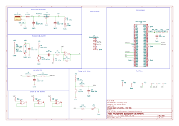

# Microphone Subsystem Schematic

**EGR 304 | Team 203 | Joseph White**

**Updated: November 25, 2026**

## Overview

This schematic represents the microphone detection subsystem designed for the EGR 304 automated cat-toy project at Arizona State University.

The subsystem uses a class-supplied two-wire electret condenser microphone, a Microchip MCP6004-I/P operational amplifier, an adjustable 10 kΩ potentiometer, and a Microchip PIC18F57Q43 Curiosity Nano.

The circuit was manufactured on a custom PCB, assembled, programmed, and tested during individual subsystem hardware verification.

## Circuit Components

- **External Power Supply:** Model 0930 AC/DC wall adapter providing 9 V DC at a rated 3 A.
- **Voltage Regulator:** STMicroelectronics L7805ABV providing a regulated 5 V supply.
- **Input Protection:** Replaceable 1 A fast-acting fuse.
- **Microphone:** Class-supplied two-wire electret condenser microphone.
- **Operational Amplifier:** Microchip MCP6004-I/P for microphone signal amplification and conditioning.
- **Potentiometer:** XCHC Electron 3296W-103, 10 kΩ adjustable trimmer.
- **Low-Pass Filter:** R9 and C5 for filtering the amplified microphone signal.
- **Microcontroller:** Microchip PIC18F57Q43 Curiosity Nano for ADC sampling, DAC output, and digital processing.
- **UART Interface:** Serial communication with other team subsystems and PuTTY debugging.
- **Debugging Components:** Pushbutton, indicator LEDs, and six test points.

## Power Supply Circuit

The subsystem receives power through barrel jack J1.

The external 9 V DC supply passes through a 1 A fuse before reaching the L7805ABV linear voltage regulator.

**9 V DC → J1 → F1 → L7805ABV → Regulated 5 V**

The regulated 5 V supply powers the microphone bias circuit, operational amplifier, microcontroller, and indicator LEDs.

No additional 3.3 V regulator is included in the manufactured subsystem.

## Microphone and Amplifier Circuit

The electret condenser microphone is biased through resistor R6, which has a resistance of 2.2 kΩ.

Capacitor C4 provides AC coupling between the microphone and the amplifier.

The MCP6004 operational amplifier uses an inverting amplifier configuration.

| Component | Value | Function |
|---|---|---|
| R6 | 2.2 kΩ | Microphone bias |
| C4 | 0.1 µF | AC coupling |
| R4 | 10 kΩ | Input bias |
| R5 | 1 kΩ | Amplifier input resistor |
| R8 | 100 kΩ | Feedback resistor |
| RV1 | 10 kΩ | Adjustable amplifier reference |
| R11 | 100 Ω | Reference voltage divider |
| R12 | 100 Ω | Reference voltage divider |

The nominal inverting-stage voltage gain is:

$$
A_v=-\frac{R_8}{R_5}
$$

$$
A_v=-\frac{100000}{1000}=-100
$$

The R11 and R12 voltage divider provides a nominal 2.5 V reference.

The RV1 potentiometer adjusts the non-inverting input voltage to establish the amplifier's DC operating point.

## Low-Pass Filter

The amplified microphone signal passes through a resistor-capacitor low-pass filter before reaching RA0.

| Component | Specified Value |
|---|---|
| R9 | 220 Ω |
| C5 | 0.22 µF |

The nominal cutoff frequency is:

$$
f_c=\frac{1}{2\pi RC}
$$

$$
f_c\approx3288\text{ Hz}
$$

The filter attenuates higher-frequency signals before analog-to-digital conversion.

## Schematic

The complete microphone subsystem schematic is displayed below.

**Figure 1:** Microphone subsystem schematic showing power regulation, microphone amplification, low-pass filtering, microcontroller connections, debugging components, and the team communication interface.

### PDF Version

The schematic is available as a PDF for detailed viewing and printing.

[View or Download Microphone Subsystem Schematic (PDF)](EGR304_JW_Microphone_Subsystem.pdf)

## Microcontroller Connections

| PIC Pin | Signal | Direction | Purpose |
|---|---|---|---|
| RA0 | RA0_ADC | Input | Conditioned microphone signal |
| RA1 | INT_OUT | Output | Digital detection signal |
| RA2 | DAC_OUT | Output | Analog DAC output |
| RC6 | UART1_TX | Output | Team serial transmit |
| RC7 | UART1_RX | Input | Team serial receive |
| RD1 | BTN | Input | PCB pushbutton |
| RD2 | LED | Output | PCB red indicator LED |
| RB4 | NANO_BUTTON | Input | Onboard Nano pushbutton |
| RF3 | NANO_LED | Output | Onboard Nano yellow LED |
| RF0 | UART3_TX | Output | PuTTY serial transmit |
| RF1 | UART3_RX | Input | PuTTY serial receive |

UART1 and UART3 are configured for 9600 baud, eight data bits, no parity, and one stop bit.

The onboard Nano pushbutton, LED, and USB serial interface are implemented on the Curiosity Nano development board.

## Team Connector

The subsystem uses an eight-pin connector, J3, for communication and integration with other team subsystems.

| Connector Pin | Signal | Type | Purpose |
|---|---|---|---|
| 1 | DAC_OUT | Analog | Assigned DAC output |
| 2 | RA0_ADC | Analog | Conditioned microphone signal |
| 3 | UART_TX | Digital | Serial transmit |
| 4 | UART_RX | Digital | Serial receive |
| 5 | INT_OUT | Digital | Detection output |
| 6 | BTN | Digital | Pushbutton signal |
| 7 | LED | Digital | Indicator LED signal |
| 8 | GND | Ground | Common ground |

The connector assignments are based on the schematic. Final continuity and team interface compatibility must be confirmed before complete system integration.

## Test Points

Six test points are included for circuit verification and troubleshooting.

| Test Point | Signal | Purpose |
|---|---|---|
| TP1 | +5V | Regulated supply voltage |
| TP2 | GND | Common ground |
| TP3 | Vref | Nominal 2.5 V reference |
| TP4 | V1 | Amplified microphone signal |
| TP5 | ADC_IN | Filtered ADC input signal |
| TP6 | VIN | External input voltage |

The pre-amplified microphone signal can be measured at MK1 pin 1.

The amplified microphone signal can be measured at TP4, and the ADC input signal can be measured at TP5.

## Debugging Circuit

The PCB includes a momentary pushbutton and red indicator LED.

The pushbutton is connected to RD1 and operates as an active-low digital input.

The red LED is connected to RD2 and operates as an active-high digital output.

The verification firmware illuminates the red LED when the PCB pushbutton is pressed.

The onboard Curiosity Nano pushbutton and yellow LED operate independently of the PCB debugging circuit.

## Hardware Verification

The microphone subsystem was manufactured, assembled, programmed, and tested.

The verification firmware reads the amplified microphone signal using the 12-bit ADC on RA0 and converts the reading into an 8-bit value for analog reproduction through the DAC on RA2.

Individual subsystem hardware verification was demonstrated to the instructor on November 25, 2026.

[View Microcontroller Code](../07-Microcontroller-Code/microcontroller-code.md)

## Resources

### Schematic PDF

[Download Schematic (PDF)](EGR304_JW_Microphone_Subsystem.pdf)

### Schematic SVG

[View Schematic (SVG)](EGR304_JW_Microphone_Subsystem.svg)

### KiCad Project Files

[Download KiCad Project (ZIP)](EGR304_JW_Microphone_Subsystem.zip)

## Design Status

**Individual Hardware Verification Complete**

The microphone subsystem has completed PCB manufacturing, component assembly, firmware development, and individual hardware verification.

Final team communication and complete system integration remain separate development activities.

## Related Documentation

- [Block Diagram](../01-Block-Diagram/Block-Diagram.md)
- [Component Selection](../02-Component-Selection/Component-Selection.md)
- [Bill of Materials](../03-BOM/BOM.md)
- [Power Budget](../05-Power-Budget/Power-Budget.md)
- [PCB Design](../06-PCB-Design/pcb-design.md)
- [Microcontroller Code](../07-Microcontroller-Code/microcontroller-code.md)
