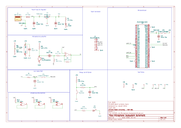

## Overview

This schematic represents the microphone subsystem designed for the EGR 304 team project at Arizona State University.

The subsystem includes:

- A 5V regulated power supply with fuse protection.
- A microphone and MCP6004 operational amplifier for sound detection.
- A PIC18F57Q43 Curiosity Nano microcontroller.
- An LED and pushbutton for testing and debugging.
- UART TX/RX connections for communication with the main controller.
- An ADC input for monitoring the microphone signal.
## Schematic

**Note:** The microphone subsystem schematic is shown below. If the image does not display due to GitHub rendering issues, the complete schematic is available as a PDF in the Resources section.

**Figure 1:** EGR 304 Microphone Subsystem Schematic.

## Resources

[Download Microphone Subsystem Schematic (PDF)](EGR304_JW_Microphone_Subsystem.pdf)

[Download KiCad Project Files (ZIP)](EGR304_JW_Microphone_Subsystem.zip)
