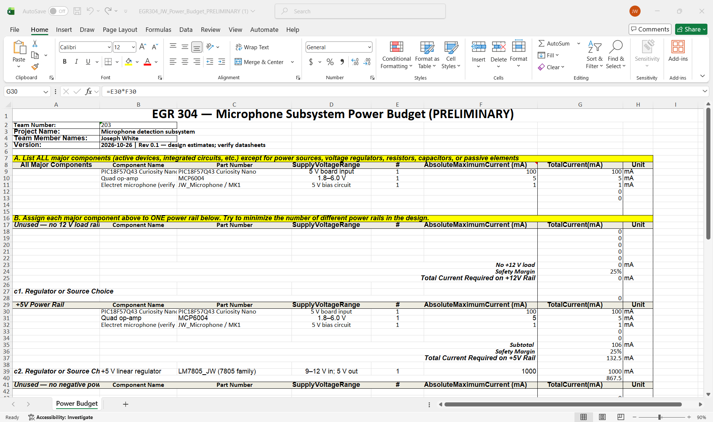
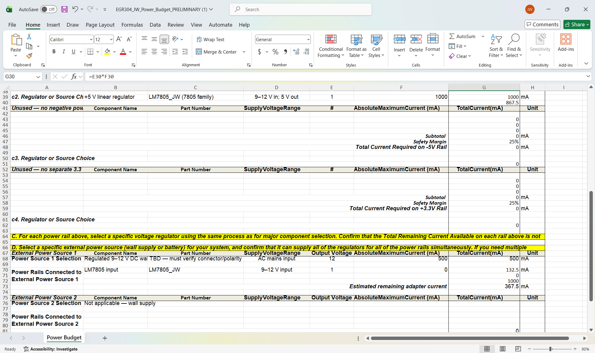
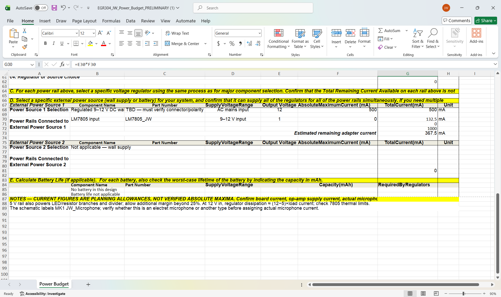

# Power Budget — Microphone Subsystem

**EGR 304 | Team 203 | Joseph White**

**Updated: November 25, 2026**

## Overview

The microphone subsystem uses a model 0930 AC/DC wall adapter providing 9 V DC at a rated output current of 3 A.

An STMicroelectronics L7805ABV linear voltage regulator provides a regulated 5 V supply for the PIC18F57Q43 Curiosity Nano, MCP6004 operational amplifier, microphone bias circuit, reference voltage circuit, and indicator LEDs.

The following power budget accounts for the components included in the manufactured subsystem.

Current values are engineering estimates and conservative design allowances rather than measured operating currents.

---

## Section A — Component Current Requirements

| Component | Reference | Supply Voltage | Estimated Current |
|---|---|---:|---:|
| PIC18F57Q43 Curiosity Nano | U2 | 5 V | 100 mA |
| MCP6004 operational amplifier | U3 | 5 V | 5 mA |
| Electret microphone bias circuit | MK1, R6 | 5 V | 2.3 mA |
| Reference voltage divider | R11, R12 | 5 V | 25 mA |
| 10 kΩ potentiometer | RV1 | 5 V | 0.5 mA |
| Green power indicator LED | D2, R1 | 5 V | 5 mA |
| Red debug LED | D3, R10 | 5 V | 15.2 mA |
| Pushbutton circuit | SW1, R3, R7 | 5 V | 0.5 mA |
| Additional analog circuit allowance | — | 5 V | 2 mA |
| **Total Estimated Load** | | | **155.5 mA** |

The current allowances for the indicator LEDs are conservative because their forward voltage reduces the actual current through their series resistors.

### Reference Voltage Divider

The reference voltage divider consists of two 100 Ω resistors connected between the 5 V supply and ground.

The reference voltage is:

$$
V_{ref}=5\left(\frac{100}{100+100}\right)=2.5\text{ V}
$$

The divider current is:

$$
I=\frac{5}{100+100}=0.025\text{ A}
$$

$$
I=25\text{ mA}
$$

### Potentiometer Current

The 10 kΩ potentiometer is connected between 5 V and ground.

$$
I=\frac{5}{10000}=0.0005\text{ A}
$$

$$
I=0.5\text{ mA}
$$

### Microphone Bias Current

The microphone receives bias current through the 2.2 kΩ resistor R6.

The conservative upper-bound current is:

$$
I=\frac{5}{2200}\approx2.3\text{ mA}
$$

The actual microphone current depends on the microphone's operating voltage and electrical characteristics.

---

## Section B — Power Rail and Safety Margin

The subsystem uses one regulated 5 V power rail.

A 25% current margin is included to account for component variation and additional operating loads.

| Parameter | Value |
|---|---:|
| Estimated component current | 155.5 mA |
| Required safety margin | 25% |
| Safety margin current | 38.875 mA |
| **Total estimated current requirement** | **194.375 mA** |
| Rounded design current | 195 mA |
| Estimated margin-adjusted 5 V load power | 0.972 W |

The margin-adjusted current requirement is:

$$
I_{design}=155.5(1.25)
$$

$$
I_{design}=194.375\text{ mA}
$$

The corresponding regulated load power is:

$$
P=VI
$$

$$
P=(5)(0.194375)
$$

$$
P\approx0.972\text{ W}
$$

---

## Section C — Voltage Regulator

The selected voltage regulator is the STMicroelectronics L7805ABV.

| Parameter | Specification |
|---|---|
| Manufacturer | STMicroelectronics |
| Part number | L7805ABV |
| Regulator type | Linear |
| Package | TO-220 |
| Nominal input voltage | 9 V DC |
| Regulated output voltage | 5 V DC |
| Rated output current | Up to 1.5 A, subject to thermal limitations |
| Estimated design load current | 194.375 mA |

[STMicroelectronics L78 Series Datasheet](https://www.st.com/resource/en/datasheet/l78.pdf)

### Regulator Power Dissipation

The approximate regulator power dissipation is:

$$
P_D=(V_{IN}-V_{OUT})I_{OUT}
$$

At the selected 9 V input:

$$
P_D=(9-5)(0.194375)
$$

$$
P_D=0.7775\text{ W}
$$

For comparison, at a 12 V input:

$$
P_D=(12-5)(0.194375)
$$

$$
P_D=1.360625\text{ W}
$$

| Input Voltage | Estimated Regulator Dissipation |
|---|---:|
| 9 V | 0.778 W |
| 12 V | 1.361 W |

These calculations exclude regulator quiescent current.

The selected 9 V adapter reduces regulator heat dissipation compared with a 12 V supply.

### Regulator Efficiency

The approximate ideal efficiency of the linear regulator is:

$$
\eta=\frac{V_{OUT}}{V_{IN}}\times100
$$

At 9 V input:

$$
\eta=\frac{5}{9}\times100
$$

$$
\eta\approx55.6\%
$$

Actual efficiency will be slightly lower when regulator quiescent current is included.

---

## Section D — External Power Source

The subsystem is powered by an external AC/DC wall adapter connected through barrel jack J1.

### Selected Power Supply

| Parameter | Specification |
|---|---|
| Manufacturer | Unbranded |
| Model | 0930 |
| Type | AC/DC wall adapter |
| AC input | 100–240 VAC |
| Input frequency | 50/60 Hz |
| DC output voltage | 9 V |
| Rated output current | 3 A |
| Rated output power | 27 W |
| Connector polarity | Center positive |

### Input Protection

A 1 A fast-acting fuse provides protection for the subsystem power input.

| Component | Specification |
|---|---|
| Manufacturer | Littelfuse |
| Part number | 0217001.MXP |
| Fuse rating | 1 A |
| Fuse dimensions | 5 × 20 mm |

### External Supply Current Budget

A conservative additional 10 mA allowance is included for voltage regulator quiescent current.

| Parameter | Value |
|---|---:|
| Margin-adjusted regulated load | 194.375 mA |
| Regulator current allowance | 10 mA |
| **Estimated adapter current requirement** | **204.375 mA** |
| Adapter rated output current | 3000 mA |
| Remaining adapter current capacity | 2795.625 mA |
| Input fuse rating | 1000 mA |

The estimated adapter input power is:

$$
P_{IN}=VI
$$

$$
P_{IN}=(9)(0.204375)
$$

$$
P_{IN}\approx1.839\text{ W}
$$

The selected adapter provides sufficient current capacity for the estimated subsystem requirements.

Although the adapter is rated for 3 A, the subsystem draws current according to its electrical load. The input circuit is protected by the 1 A fuse.

### Power Architecture

**9 V DC Wall Adapter → J1 → F1 → L7805ABV → Regulated 5 V Supply**

The regulated supply powers:

- PIC18F57Q43 Curiosity Nano.
- MCP6004 operational amplifier.
- Electret microphone bias circuit.
- Reference voltage divider.
- Adjustable potentiometer.
- Indicator LEDs.
- Pushbutton circuit.

---

## Section E — Battery Life

Battery life is not applicable to the manufactured microphone subsystem because it uses an external AC/DC wall adapter.

A rechargeable battery power architecture may be evaluated separately during final team integration if required.

---

## Section F — Power Budget Summary

| Parameter | Value |
|---|---:|
| External input voltage | 9 V DC |
| External adapter capacity | 3 A |
| Regulated output voltage | 5 V DC |
| Estimated circuit load | 155.5 mA |
| Current safety margin | 25% |
| Margin-adjusted load | 194.375 mA |
| Estimated adapter current | 204.375 mA |
| Estimated regulated load power | 0.972 W |
| Estimated input power | 1.839 W |
| Approximate regulator dissipation, excluding quiescent current | 0.778 W |
| Approximate ideal regulator efficiency | 55.6% |
| Input fuse rating | 1 A |

---

## Hardware Verification

The microphone subsystem PCB was manufactured, assembled,
programmed, and tested.

Individual hardware verification was demonstrated to the
instructor on November 25, 2026.

The power budget represents calculated design allowances.
Actual operating current and regulator temperature have not
been recorded as part of this power budget.

---

## Original Power Budget Spreadsheet Images

The following images document the preliminary power budget
developed during the external design review.

The revised calculations presented above supersede the
preliminary component current estimates.

### Component Current Requirements and 5 V Rail

### Voltage Regulators and External Supply

### External Power Supply, Battery Life, and Notes

## Excel Power Budget

[Download the original preliminary microphone subsystem power budget](EGR304_JW_Power_Budget_PRELIMINARY.xlsx)

---

## Design Conclusions

The microphone subsystem uses a single regulated 5 V supply.

The estimated regulated current requirement, including a
25% safety margin, is approximately 195 mA.

The selected STMicroelectronics L7805ABV regulator and
model 0930 external 9 V DC wall adapter provide sufficient
nominal current capacity for the estimated load.

Regulator heat dissipation remains an important design
consideration.

**Status: Individual Hardware Verification Complete —
Power Budget Updated.**

---

## Related Documentation

- [Block Diagram](../01-Block-Diagram/Block-Diagram.md)
- [Component Selection](../02-Component-Selection/Component-Selection.md)
- [Bill of Materials](../03-BOM/BOM.md)
- [Electrical Schematic](../04-Schematic/schematic.md)
- [PCB Design](../06-PCB-Design/pcb-design.md)
- [Microcontroller Code](../07-Microcontroller-Code/microcontroller-code.md)
