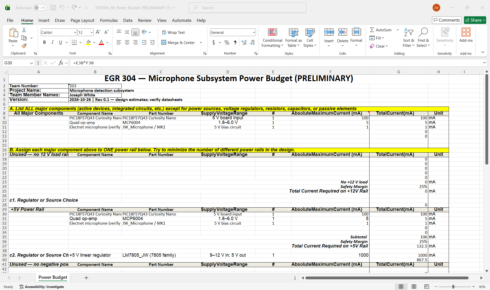
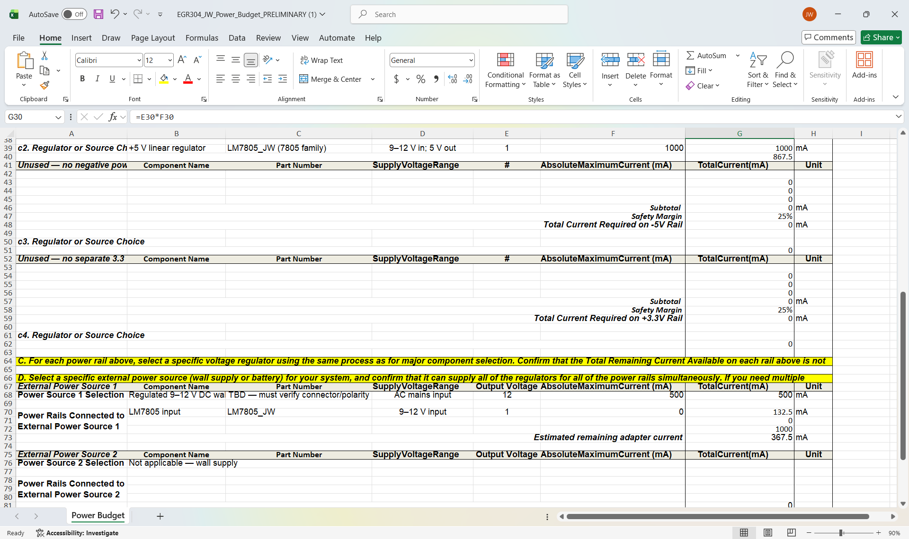
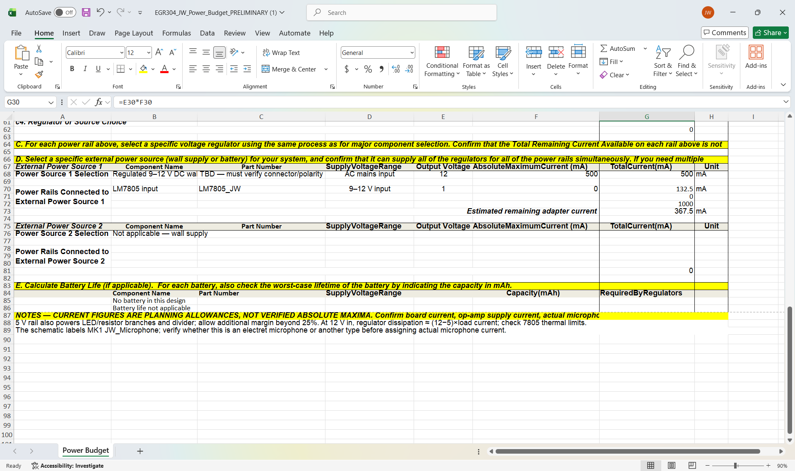

# Power Budget — Microphone Subsystem

**EGR 304 | Team 203**

## Overview

The microphone subsystem uses a 9–12 V DC input and an LM7805 linear voltage regulator to provide a regulated 5 V power rail. This rail supplies the PIC18F57Q43 Curiosity Nano development board and the microphone signal-conditioning circuit.

The following power budget is preliminary. Current values are design estimates pending verification against the final component datasheets.

## Section A — Component Current Requirements

| Component | Supply Voltage | Estimated Current |
|---|---:|---:|
| PIC18F57Q43 Curiosity Nano | 5 V input | 100 mA |
| MCP6004 operational amplifier | 5 V | 5 mA |
| Microphone circuit | 5 V | 1 mA |
| **Total** | | **106 mA** |

The values above are preliminary allowances, not confirmed absolute maximum currents. Additional small loads, including the indicator LED, must be checked before finalizing the budget.

## Section B — Power Rail and Safety Margin

The subsystem uses one regulated 5 V rail.

| Parameter | Value |
|---|---:|
| Estimated component current | 106 mA |
| Required safety margin | 25% |
| Safety margin current | 26.5 mA |
| **Estimated current requirement** | **132.5 mA** |
| Estimated 5 V load power | 0.6625 W |

The 25% safety margin is applied to the estimated operating current:

106 mA × 1.25 = 132.5 mA

## Section C — Voltage Regulator

The selected regulator is the LM7805 linear voltage regulator.

- Input: 9–12 V DC
- Regulated output: 5 V DC
- Regulator output current requirement: approximately 133 mA, based on preliminary estimates

At the maximum 12 V input, estimated regulator power dissipation is:

P = (12 V - 5 V) × 0.1325 A

P = 0.9275 W

This is a preliminary conservative calculation using the margin-adjusted current. Thermal performance must be checked before final PCB fabrication.

## Section D — External Power Source

The subsystem is designed to use an external 9–12 V DC supply through a barrel jack.

The final power supply must support the subsystem's maximum current requirements with the specified safety margin. A specific adapter's rated output current must be confirmed before calculating remaining available current.

## Section E — Battery Life

Battery life is not applicable because the current design uses an external DC power supply rather than a battery.

## Design Conclusions

The preliminary budget indicates that the microphone subsystem has relatively modest power requirements. A single regulated 5 V rail simplifies the design and reduces the number of required power components.

The primary concern identified is heat dissipation in the LM7805 regulator, particularly when operating from a 12 V input.

Before finalizing the design, the maximum current consumption of each active component, the complete load current, the selected adapter's current rating, and the regulator's thermal performance will be verified.

## Power Budget Spreadsheet Images

### Component Current Requirements and 5 V Rail

### Voltage Regulators and External Supply

### External Power Supply, Battery Life, and Notes

## Excel Power Budget

[Download the preliminary microphone subsystem power budget](EGR304_JW_Power_Budget_PRELIMINARY.xlsx)

**Status: Preliminary — pending datasheet verification and final power supply selection.**
