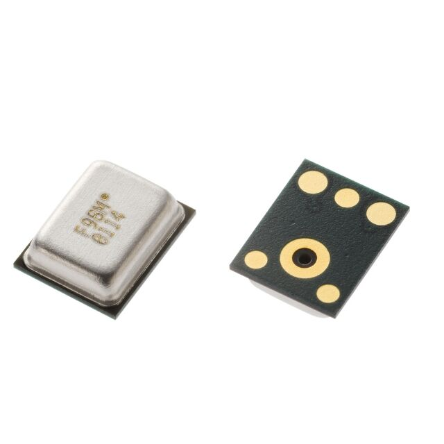
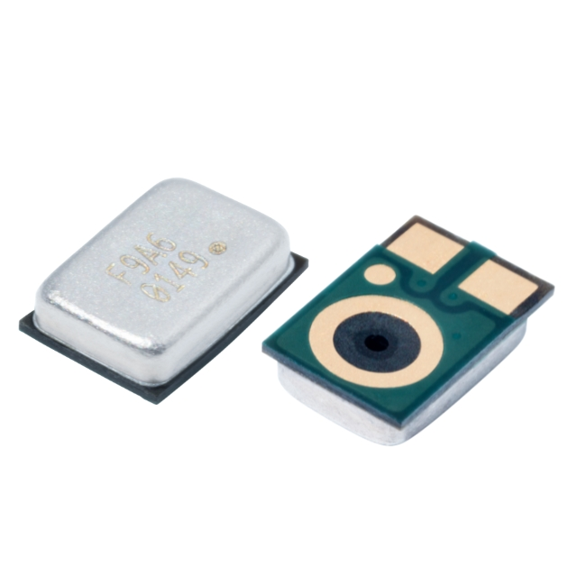
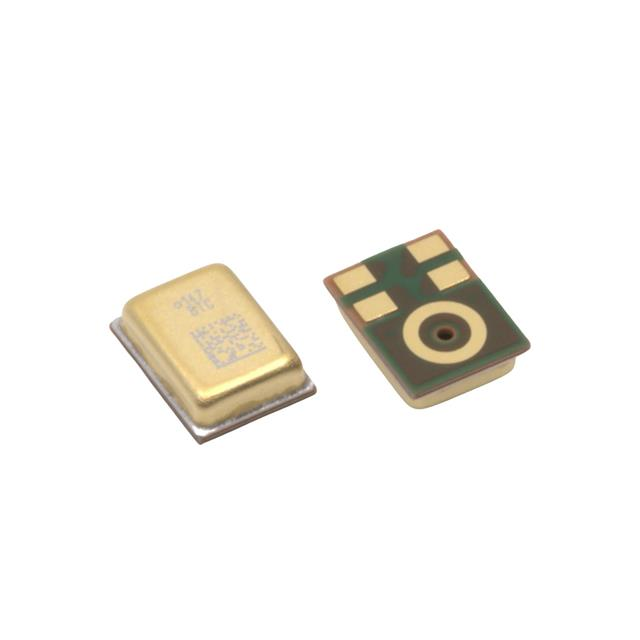
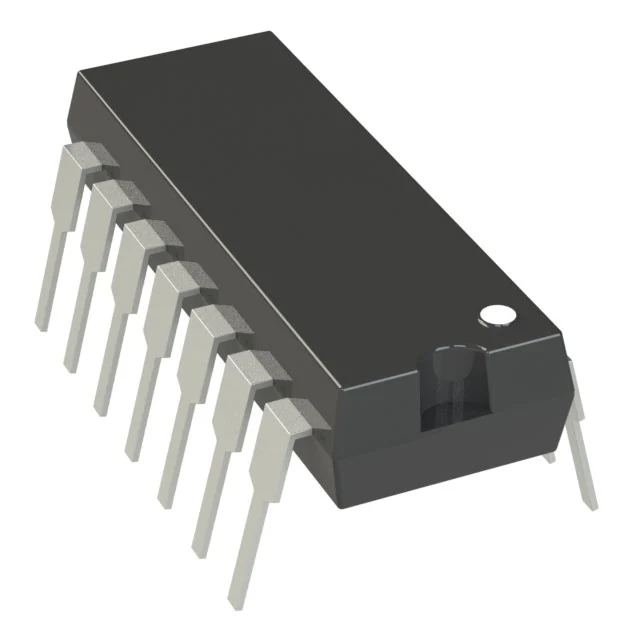
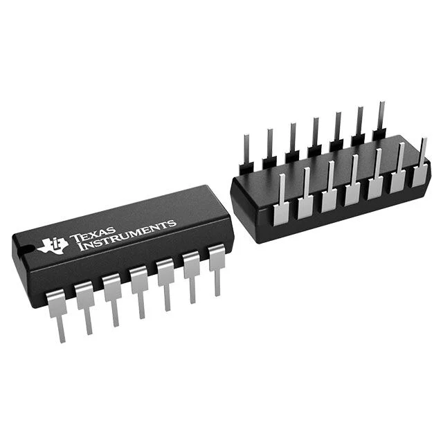
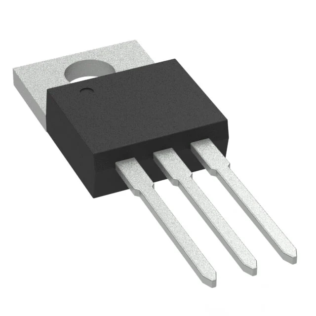
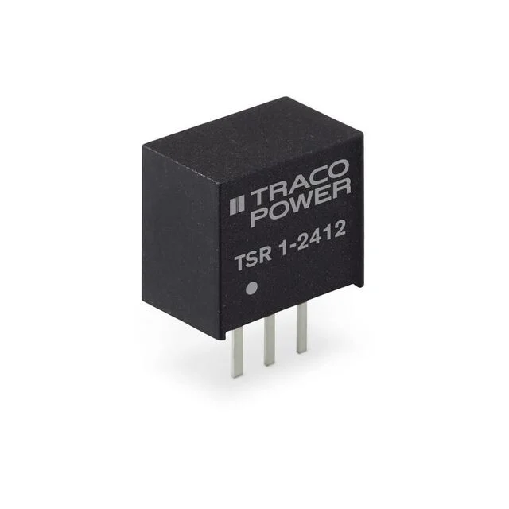

```markdown
---
title: Component Images
---

# Component Images — Microphone Subsystem

**EGR 304 | Team 203 | Joseph White**

## Overview

This section contains component photographs and supporting images used throughout the microphone subsystem design documentation.

The images below support the component comparisons presented in the Component Selection section.

---

## 1. Microphone Options

### Option 1 — 3S 3SM121MZB1UA



### Option 2 — 3S 3SM122KZB1VD-002-R



### Option 3 — Syntiant SPH11C3LR5H-1



---

## 2. Operational Amplifier Options

### Option 1 — Microchip MCP6004



### Option 2 — Microchip MCP6002



### Option 3 — Texas Instruments LM324


---

## 3. Voltage Regulator Options

### Option 1 — STMicroelectronics L7805CV



### Option 2 — Traco Power TSR 1-2450



---

## 4. Design Documentation

The images above were used to compare components during the initial microphone subsystem design process.

For technical specifications, component comparisons, and selection rationale, see the following page:

[Component Selection — Microphone Subsystem](../02-Component-Selection/Component-Selection.md)

---

## 5. Notes

Some photographs represent component packages rather than exact manufacturer markings.

The final microphone subsystem design uses the class-supplied microphone, MCP6004 operational amplifier, 10 kΩ potentiometer, and LM7805 voltage regulator.

The alternative components shown above were evaluated during the component selection process.

---

**EGR 304 — Embedded Systems Design**

**Team 203 | Joseph White**
```
